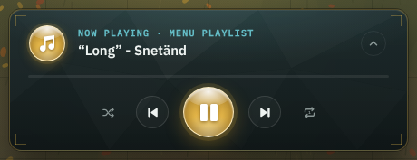
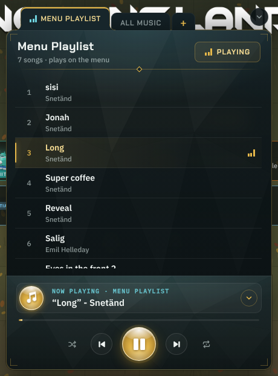
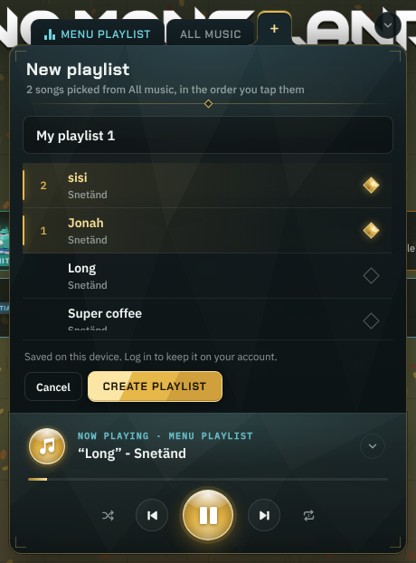
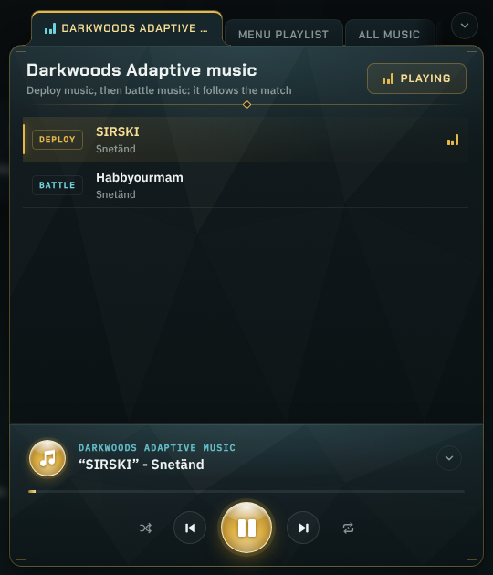

# UI style: Gilded low-poly glass

The look made for the music player and its playlist panel (7 November 2026). This is the reference for using it
on the rest of the UI: the menus, sheets, HUD and buttons.

The working code is the music player in `src/site-template.html`. To find it, search for
`/* the music player (2026-11-07` for the CSS and `const playerHtml` / `function mpListHtml` for the markup.

| The player | The panel open | Making a playlist | In a match |
|---|---|---|---|
|  |  |  |  |

---

## 1. The idea in one line

**Dark teal glass with faint low-poly facets, kept flat and quiet, trimmed in gold, and one or two glossy gold
orbs for the actions that matter most.**

It mixes four styles, each with one job. Keep each style in its job and don't let one spread.

| Style | Its job | Where it shows | Don't |
|---|---|---|---|
| **Low-poly 3D** | Presentation: ties the UI to the game's low-poly units and boards | Faint triangle facets in panel backgrounds | No bevelled or faceted buttons, no gem-cut controls (tried, rejected) |
| **Frutiger (Aero)** | Identity and atmosphere | A soft teal glow at the top of surfaces, light frosted glass, teal status labels, **the glossy gold orbs** | No glossy shine on every button, no bubbly aqua, no big rounded capsules (the first version did this and was "too Frutiger") |
| **Minimalist modern** | Navigation and usability | Flat tabs, lists on thin dividers, outline buttons, clear type, one primary action per view | No borders and cards nested in borders and cards |
| **Ornate royal** | The premium feel | Gold border, gold corner brackets, the gold rule with a diamond, the gold top edge on the picked tab, the gold bar on the selected row, gold diamond checks | No filigree, scrollwork or serif fonts. The ornament is thin, sharp lines only |

**Gloss is the exception.** Only the hero actions get the glossy gold orb: Play / Pause and the note badge in the
player. On another screen that is one or two things, such as the main Play button or a "ready" button in a match.
If everything is glossy, nothing stands out and the look falls back into full Frutiger Aero.

---

## 2. Tokens

They are defined on `:root` with the `--mp-` prefix. For the whole UI, move them to `src/game.css` `:root` with a
neutral prefix (for example `--ui-`).

### Colour

| Token | Value | Use |
|---|---|---|
| `--mp-gold` | `#E6B84A` | The accent: borders of selected things, focus rings, the selected-row bar, icons on hover. The same as the game's `--gold` |
| `--mp-gold-hi` | `#F8DE94` | Gold text on dark (selected tab, selected song title), hover highlights |
| `--mp-gold-dk` | `#A27C2A` | The dark end of gold gradients |
| `--mp-line` | `rgba(230,184,74,0.32)` | Gold hairlines: outer frames, corner brackets, the diamond rule, outlined secondary actions |
| `--mp-teal` | `#6FD3DE` | Atmosphere and status: small mono labels ("NOW PLAYING"), "playing" markers on tabs, info chips. Never for actions |
| `--mp-ink` | `#EEF3F1` | Main text |
| `--mp-dim` | `rgba(214,228,226,0.6)` | Secondary text, idle icons, row numbers |
| `--mp-hair` | `rgba(255,255,255,0.07)` | Neutral hairlines: list dividers, inner borders, idle tabs |
| `--mp-top` | `#17262B` | The top colour of a surface. The picked tab uses exactly this colour, so the tab flows into the panel |
| `--mp-bot` | `#0C1416` | The bottom colour of a surface |

How the colours split up:
- **Gold** marks what you can act on, what is selected, and what is premium.
- **Teal** marks what is happening (status and atmosphere).
- **Ink** is everything else.

Red (`#E07A6A`, text `#F2B2A6`) appears only for danger confirmations such as "Sure? Delete".

### Layers (reusable backgrounds)

| Token | What it is |
|---|---|
| `--mp-facets` | An inline SVG of 14 white triangles at 0.4-4.5 % opacity, stretched to the surface (`0 0 / 100% 100%`). This is the low-poly texture. Keep it below 5 % opacity |
| `--mp-corners-top` / `--mp-corners-bot` | Gold L-brackets, 12 px each way, 6 px in from each corner, drawn with `linear-gradient` layers. Use them only on the **outermost** frame of a surface. When two surfaces are joined (the panel on the player), the upper one keeps only its top pair and the lower one only its bottom pair, so together they read as one frame |
| `--mp-glass` | A teal radial glow at the top (`rgba(111,211,222,0.16)`) over a vertical dark gradient (`rgba(23,38,43,.9)` to `rgba(12,20,22,.94)`) |

### Type

All of these fonts are already loaded by `game.css`.

| Role | Font | Size and weight | Case |
|---|---|---|---|
| Panel title | `--font-display` (Chakra Petch) | 700, 19 px, letter-spacing .02em, at most 2 lines | Sentence case |
| Tabs, primary buttons | `--font-display` | 600 to 700, 12 px, letter-spacing .07 to .08em | **UPPERCASE** |
| Body, list titles | `--font-body` (IBM Plex Sans) | 600, 14 to 15 px | Sentence case |
| Secondary lines | `--font-body` | 500, 11.5 to 12 px, `--mp-dim` | Sentence case |
| Status labels, numbers, chips | `--font-data` (IBM Plex Mono) | 500 to 600, 9.5 to 12 px, letter-spacing .1 to .12em for labels | UPPERCASE labels, teal |

### Shape and size

| Thing | Value |
|---|---|
| Surfaces (cards, panels, the player) | 14 px radius. Joined edges are square |
| Tabs | 9 px top radius, square bottom |
| Buttons (pill / ghost) and inputs | 8 px radius: a little rounded, not a capsule |
| Icon buttons | Circles, 30 to 36 px |
| Hero orb | Circle, 54 to 58 px (40 px for a badge) |
| Selection diamond | 13 px square, turned 45° |
| Spacing | 16 px surface padding, 10 to 14 px gaps, 50 px list rows |

---

## 3. Components

The **class** column gives the music player's class, which is the code to copy.

### Surface (panel, card, sheet)
Class: `.mplayer`, `.mp-body`.
- Background layers, top to bottom: corner brackets, `--mp-facets`, `--mp-glass`.
- `border: 1px solid var(--mp-line)`, 14 px radius.
- `box-shadow: inset 0 1px 0 rgba(255,255,255,.07), 0 0 0 1px rgba(0,0,0,.35), 0 16px 36px rgba(0,0,0,.45)`.
- `backdrop-filter: blur(12px)` is the only "glass" effect. Keep it light.

### Header with the diamond rule
Class: `.mp-head`.
- The title, a dim subtitle under it, and the actions on the right.
- Underneath sits a 1 px gold rule that fades out at both ends, with a 7 px outlined gold diamond in the middle (`::after` and `::before`).
- Use it once per surface, at the top. This is the main ornament.

### Folder tabs
Class: `.mp-tab`.
- Idle tabs: flat dark (`#142126` to `#0F191C`), hairline border, dim uppercase text, set 4 px down so they sit behind.
- The picked tab:
  - It is 6 px taller and filled with exactly `--mp-top`, with a gold `inset 0 2px 0` top edge and gold-hi text.
  - Two 10 px radial-gradient curves at its feet (`::before`, `::after`) flow it into the panel below.
  - The tab row overlaps the panel by `-1px` so the tab covers the panel's top border.
- A "playing" or "active" tab gets teal text and a small equalizer.
- A **+** tab at the end, in gold, makes something new.
- When there are too many tabs, the row scrolls sideways (the mouse wheel works too). The edge with more tabs fades out with `mask-image`, and the picked tab is scrolled into view.

### Lists
Class: `.mp-song`.
- Rows are 50 px tall, with no box and only a `--mp-hair` divider underneath. Hover is a 3.5 % white wash.
- The **selected or active** row has:
  - a 2 px gold bar on its left with a soft gold glow,
  - a gold wash fading from the left (`rgba(230,184,74,.13)` to transparent),
  - the title in gold-hi, the number in gold, and a gold equalizer on the right.
- The leading column holds a mono number, or a **chip** (`.mp-n em`): mono 9.5 px uppercase in a hairline box, teal (gold when selected).

### Buttons (four levels, use them in this order)

| Level | Class | Look | Use |
|---|---|---|---|
| **Hero** | `.mp-main` | **The glossy gold orb**: a white highlight at the top (`radial-gradient(78% 48% at 50% 8%, white .92 to transparent)`) over `radial-gradient(110% 110% at 50% 100%, #FFE9A8, #E6B84A 46%, #9C7424)`, a cream border, a dark-gold shadow inside at the bottom, a faint gold ring and glow. White icon with a dark-gold drop shadow | One or two per screen: the action the screen exists for |
| **Primary** | `.mp-pill` | A flat gold block with hard diagonal "facet" stops (`linear-gradient(115deg, #FBE6A6 0 30%, #E6B84A 30% 62%, #CFA03C 62%)`), dark text in uppercase display type, 8 px radius | The main action inside a panel (Play, Create playlist) |
| **Primary, already active** | `.mp-pill[aria-pressed=true]` | Gold outline, gold text, transparent fill, with an equalizer | Shows that this is the one already chosen ("Playing") |
| **Secondary** | `.mp-ghost` | Transparent, 12 % white hairline, ink text. On hover the line and text turn gold | Edit, Cancel, Delete |
| **Icon** | `.mp-btn` | A 36 px circle, 12 % white hairline, 3 % white fill. On hover: gold icon, gold line, faint gold fill. Pressed: scale .93 | Back, Next, Close |
| **Toggle** | `.mp-mode` | A bare icon. On: a gold icon in a gold hairline circle with a faint gold fill | Shuffle, Repeat, any on/off option |

The **badge** (`.mp-disc`) is a 40 px version of the hero orb that holds an icon. It marks the identity of a
surface. Centre icons by their real bounds (see the note in section 6).

### Inputs
Class: `.mp-name`.
- 42 px tall, 8 px radius, 28 % black fill, 12 % white hairline.
- On focus: a gold border and a 3 px gold ring at 18 %.
- Placeholder text at 40 % ink.

### Selection mark
Class: `.mp-check`.
- A 13 px square turned 45° (a diamond), drawn as a hairline.
- When picked, it is filled with the gold gem gradient and glows gold. This is the royal touch in place of a checkbox.
- In a multi-pick list, the row also gets the selected-row treatment and a number for the order it was picked in.

### Progress
Class: `.mp-prog`.
- A 3 px track at 8 % white, filled with a gold gradient (`--mp-gold-dk` to `--mp-gold-hi`) and a faint teal glow.

### Activity indicator
Class: `.mp-eq`.
- Three 2.5 px bars that bounce. Gold in lists and buttons, teal in tabs.
- They only move while something is actually playing or running (`animation-play-state`).

### Overlay and backdrop
Class: `.mp-pop.dock`.
- `rgba(5,9,10,.6)` with a faint teal glow from the bottom, and `blur(4px)`.
- Clicking the backdrop closes it, and so does Escape.

---

## 4. Motion

| What | How |
|---|---|
| A panel opening from something on screen | **Roll up out of it**: `clip-path: inset(100% … round …)` to `inset(-40px …)`, plus a 16 px rise and a fade, 0.4 s `cubic-bezier(.16,.9,.24,1)`. The thing it rolls out of stays still. Closing runs the same in reverse in 0.26 s |
| A panel with no anchor on screen | It rises from the bottom (40 px, 0.3 s) and the backdrop fades in |
| Hover / press | 0.12 to 0.18 s. Press scales to .93 to .97 |
| Ambient | Only on things that are live: the equalizer, the note bobbing while music plays |
| Reduced motion | Everything above turns off (`@media (prefers-reduced-motion: reduce)`) |

---

## 5. Rebuilding the whole UI in this style

### Order
1. **Tokens first.** Move the `--mp-*` tokens and the three layers from `src/site-template.html` into `src/game.css` `:root` as `--ui-*`, and point the music player at them. Nothing should look different afterwards.
2. **Sheets** (`.sheet`, `.sheet-back`): give them the surface recipe, the diamond-rule header and the backdrop. Sheets cover most screens (Settings, Profile, Friends, unit sheets), so this changes the most for the least work.
3. **Buttons**:
   - `.btn` becomes the secondary (ghost) style.
   - `.btn.primary` becomes the gold facet pill.
   - `.hbtn.gold` and `.play-big` become the **hero orb** idea. For a wide button, keep the orb's gloss and gradient but give it an 8 to 14 px radius instead of a circle.
   - `.cog` becomes the icon button.
   - `.seg` (On / Off pairs) becomes toggles, with the picked side in the toggle-on style.
4. **Home screen**: `.tiles` buttons become surface tiles with corner brackets; rewards cards become surfaces with a gold edge only when they can be claimed.
5. **Lists and tables** (the leaderboard, match history, friends, the encyclopedia): use the list row recipe.
6. **The match HUD and the deploy panel come last.** They sit over the board, so use the glass and the dark tokens there, but **no** facets or corner brackets on small HUD pieces, because they get busy over the 3D board. Save the ornament for big surfaces.

### Rules that keep it from going wrong
- **One hero per screen**, two at most. Count the glossy orbs.
- **Facets stay faint.** If you notice them before the content, they are too strong.
- **Corner brackets only on outer frames**, never on rows or buttons. Joined surfaces share one set.
- **Gold means "act or selected", teal means "status".** Don't swap them.
- **Flat inside, ornate outside.** Inside a surface: hairlines, flat rows, outline buttons. The outer frame carries the gold.
- **Uppercase only for short labels**: tabs, chips, primary buttons. Never for sentences or titles.
- Keep the game's readability rules: text at least 11.5 px, focus rings in 2 px gold, and tap targets at least about 36 px (44 px for the main buttons on phones).

### Watch out for
- Any surface that might sit over the 3D board needs the opaque end of the glass gradient (≥ .9 alpha), or the board shows through.
- `clip-path` animations clip box-shadows. Use generous negative insets, as the roll-up does (`-40px`).
- A tab that flows into a panel needs **exactly** the panel's top colour (`--mp-top`), and the tab row must overlap the panel by 1 px.
- iPhone: `backdrop-filter` needs `-webkit-backdrop-filter` too. Use `dvh` along with `vh` for heights.

---

## 6. Notes

- **Centre icons by what they draw, not by their box.** The game's note icon (`NOTE_SVG`) sits about half a unit right of and above the middle of its 24-unit box (its real bounds are x 4 to 21, y 2 to 20.8). The badge therefore uses its own copy with `viewBox="3.01 1.88 19 19"` (`DISC_NOTE`). Check other icons the same way (`getBBox()` in a browser) before putting them in an orb.
- **How the look was arrived at, so nobody repeats the dead ends:**
  - The first pass was full Frutiger Aero: glossy aqua capsules, bubble buttons, glossy pills on every row. It was too much.
  - The second pass used the four-style mix in this doc and gem-cut gold controls. The gem-cut look was rejected for Play / Pause and the badge, which became the glossy gold orb, the one place full Frutiger gloss stays.
